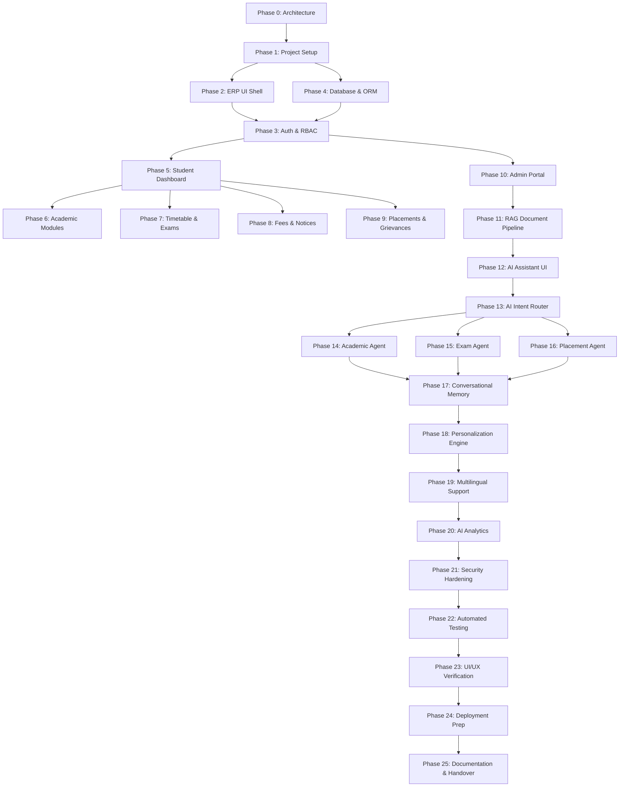

# AI-Integrated University Student Support ERP
## Master Phase Development Roadmap (Phases 0 – 25)

---

### Executive Summary & Research Foundation
The **AI-Integrated University Student Support ERP** is an enterprise-grade platform uniting comprehensive academic lifecycle management with an academic-grade multi-agent Generative AI & Retrieval-Augmented Generation (RAG) subsystem. Rooted in research (*"Generative AI Agent for University Student Support Using Retrieval-Augmented Generation and Conversational Memory"*), the system enforces:
- **Strict Anti-Hallucination**: Grounded policy retrieval with page-level citations.
- **Deterministic Business Calculations**: CGPA, exam eligibility, and fee balances computed via backend business logic, not inferred by LLMs.
- **Zero-Trust Student Isolation**: Rigorous row-level tenant isolation by student ID and role-based access control (RBAC).
- **Trilingual Academic NLP**: Support for English, Kannada (ಕನ್ನಡ), and Hindi (हिन्दी).

---

## Roadmap Overview & Phases Matrix

| Phase | Category | Phase Title | Status | Primary Focus |
| :---: | :--- | :--- | :---: | :--- |
| **0** | Foundation | Requirements & Architecture | 🟢 Completed | System design, monorepo architecture, schema specs, API design |
| **1** | Foundation | Monorepo & Project Scaffolding | 🟢 Completed | FastAPI backend, Vite React TS frontend, Tailwind v4 integration |
| **2** | UI/UX Shell | Design System & ERP Shell | 🟢 Completed | Theme tokens, responsive sidebar, topbar, breadcrumbs, notifications |
| **3** | Security | Authentication & RBAC | 🟢 Completed | JWT auth, login flow, role guards (Student/Admin/Faculty), AuthContext |
| **4** | Persistence | Database Models & Seed Engine | 🟢 Completed | SQLAlchemy 2.0 ORM schemas, SQLite/PostgreSQL support, sample dataset |
| **5** | Core ERP | Student Dashboard | 🟢 Completed | Metric cards (CGPA, Attendance, Credits), widgets, chart visualizations |
| **6** | Core ERP | Academic Modules | 🟢 Completed | Course catalog, circular attendance gauges, marks breakdown, transcripts |
| **7** | Core ERP | Timetable & Examinations | 🟢 Completed | Weekly schedule, exam calendars, seat allocations, eligibility rule engine |
| **8** | Core ERP | Fees, Notices & Documents | 🟢 Completed | Fee status, payment histories, notice board with filters, document downloads |
| **9** | Core ERP | Placement & Grievances | 🟢 Completed | Campus recruitment portal, skill matching, grievance ticketing system |
| **10**| Administration | Admin Management Portal | 🟢 Completed | Admin dashboard, student registry, document upload, vector index rebuilds |
| **11**| AI Engine | RAG Document Ingestion Pipeline | 🟢 Completed | PDF parsing, semantic chunking, SentenceTransformers, FAISS indexing |
| **12**| AI UI | AI Student Assistant Drawer & Hub | 🟢 Completed | Collapsible floating AI drawer, dedicated AI Chat page, citation badges |
| **13**| AI Engine | Deterministic Intent Router | 🟢 Completed | Query classification, prompt routing to specialized domain agents |
| **14**| AI Agents | Academic Agent | 🟢 Completed | Deterministic attendance/marks lookup, low-attendance proactive warnings |
| **15**| AI Agents | Examination Agent | 🟢 Completed | Schedule retrieval, eligibility evaluations, hall ticket status inquiries |
| **16**| AI Agents | Placement Agent | 🟢 Completed | Corporate drive matching, 1.5x CTC upgrade rules, skill gap analyzer |
| **17**| AI Engine | Conversational Memory Engine | 🟢 Completed | Multi-turn session memory, sliding window context, anaphora resolution |
| **18**| AI Engine | Personalization Engine | 🟢 Completed | Dynamic student context injection (department, semester, grades, fee dues) |
| **19**| AI Engine | Multilingual Processing Engine | 🟢 Completed | Trilingual query detection and response generation (EN, KN, HI) |
| **20**| AI Analytics | Proactive AI Insights & Summaries | 🟢 Completed | Weekly briefing, multi-dimensional risk radar, smart study scheduler |
| **21**| Security | Security Hardening & Audit | 🟢 Completed | Prompt injection defenses, IDOR row-level protection, XSS sanitization |
| **22**| Quality | Automated Testing Suite | 🟢 Completed | 84 Pytest unit & integration test suite passing at 100% |
| **23**| Quality | UI/UX Verification & Accessibility | 🟢 Completed | Cross-device responsive audits, WCAG 2.1 AA compliance, Vite TS clean build |
| **24**| Operations | Deployment & Production Readiness | 🟢 Completed | Multi-stage Dockerfiles, Nginx SPA proxy, docker-compose orchestration |
| **25**| Handover | Documentation & Handover | 🟢 Completed | Master roadmap 100%, API reference documentation, architectural reports |

---

## Detailed Phase Breakdown (Phases 0 – 25)



---

### Phase 0: Requirements & Architecture Specification
- **Objective**: Establish foundational blueprint, system boundaries, and architectural patterns.
- **Key Deliverables**:
  - Technical architecture specification ([docs/architecture.md](file:///c:/Users/vaish/OneDrive/Desktop/AI-University-ERP/docs/architecture.md)).
  - Relational ER schema and RAG vector store design.
  - Initial setup guide ([docs/setup.md](file:///c:/Users/vaish/OneDrive/Desktop/AI-University-ERP/docs/setup.md)).
- **Verification**: Architectural review and sign-off.

---

### Phase 1: Monorepo & Project Scaffolding
- **Objective**: Initialize development environments for both backend and frontend.
- **Key Deliverables**:
  - FastAPI backend structure with ASGI runner and CORS middleware (`backend/app/main.py`).
  - Vite React TypeScript frontend setup with Tailwind CSS v4 (`@import "tailwindcss"`).
  - Health check endpoint (`/api/v1/health`) and basic smoke tests (`tests/test_health.py`).
- **Verification**: `npm run build` succeeds; backend passes smoke tests.

---

### Phase 2: Design System & ERP UI Shell
- **Objective**: Create the university-grade visual theme and responsive application shell.
- **Key Deliverables**:
  - High-fidelity typography, color palettes (slate, deep navy, vibrant primary), and glassmorphism cards.
  - Collapsible Sidebar with module navigation, active state badges, and role-based filtering.
  - Top Navigation Bar with academic term selector, notifications bell, quick AI launch button, and user profile menu.
  - Reusable UI primitives: `Card`, `Badge`, `Button`, `Table`, `Modal`, `StatsCard`, `AlertBanner`.
- **Verification**: Responsive rendering tested across mobile (375px), tablet (768px), and desktop (1440px).

---

### Phase 3: Authentication System & RBAC
- **Objective**: Implement secure authentication, session management, and role-based guards.
- **Key Deliverables**:
  - Backend JWT authentication (`/api/v1/auth/login`, `/api/v1/auth/me`, `/api/v1/auth/refresh`).
  - Password hashing with bcrypt via passlib.
  - Frontend `AuthContext`, login page with credentials/demo quick-fill, persistent token storage.
  - Protected route wrappers enforcing student vs. admin permissions (`ProtectedRoute`).
- **Verification**: Unauthorized requests return 401; student cannot access admin routes (403).

---

### Phase 4: Database Models & Seed Data Engine
- **Objective**: Implement SQLAlchemy 2.0 ORM schemas and a realistic university seed generator.
- **Key Deliverables**:
  - Relational models: `User`, `Student`, `Department`, `Course`, `Enrollment`, `Attendance`, `InternalMark`, `ExamSchedule`, `FeeRecord`, `Notice`, `PlacementDrive`, `Grievance`, `ChatSession`, `ChatMessage`.
  - SQLite (local) and PostgreSQL (production) engine configuration.
  - Comprehensive seed script (`backend/app/db/seed.py`) populating sample students, courses, attendance records, exam schedules, and university notices.
- **Verification**: Automated database initialization and table integrity validation.

---

### Phase 5: Student Dashboard
- **Objective**: Construct the centralized student home screen displaying real-time academic vitals.
- **Key Deliverables**:
  - KPI Stat Cards: Current CGPA, Overall Attendance %, Earned Credits, Pending Fee Balance.
  - Circular Attendance Progress Visualizer with minimum threshold alert (< 75%).
  - Today's Classes schedule widget with room numbers and faculty details.
  - Upcoming Exam Countdown and Recent Campus Announcements ticker.
  - Quick-action buttons: "Ask AI", "View Hall Ticket", "Pay Fees".
- **Verification**: Dashboard renders accurate student metrics from backend API.

---

### Phase 6: Academic Modules (Courses, Attendance & Marks)
- **Objective**: Deliver detailed academic record inspection for enrolled subjects.
- **Key Deliverables**:
  - Course Registration & Syllabus view with credit distributions.
  - Subject-wise Attendance Breakdown table with attended/total classes, percentage, and safe bunk/shortage calculators.
  - Internal Assessment & Semester Exam Marks ledger with graphical grade trends.
  - Semester Transcripts & CGPA progression chart powered by Recharts.
- **Verification**: Precise calculations matching academic grading regulations.

---

### Phase 7: Timetable & Examination Engine
- **Objective**: Provide structured weekly timetables and complete examination management.
- **Key Deliverables**:
  - Dynamic Weekly Timetable grid (Monday – Saturday) with period slots and lab indicators.
  - Exam Schedule portal with date, time, subject code, room number, and seat number.
  - Deterministic Exam Eligibility Calculator (Attendance >= 75% AND Fee Dues == 0).
  - Digital Hall Ticket generator with printable layout and QR verification code.
- **Verification**: Ineligible students are correctly blocked with detailed remediation steps.

---

### Phase 8: Fees, Notices & Document Center
- **Objective**: Handle financial accounting, administrative bulletins, and institutional downloads.
- **Key Deliverables**:
  - Fee breakdown: Tuition, Laboratory, Library, Exam Fees with payment history & receipt download.
  - University Notice Board with category filters (Academic, Exams, Events, Placement).
  - Digital Document Locker: Semester Marksheets, Bonafide Certificates, Bus Passes, Syllabus PDFs.
- **Verification**: File download integrity and real-time notice filtering.

---

### Phase 9: Placement Portal & Grievance Management
- **Objective**: Support career recruitment activities and student grievance resolution.
- **Key Deliverables**:
  - Placement Drive catalog with eligibility criteria (Min CGPA, No Backlogs), job descriptions, and CTC.
  - One-click application submission and status tracker (Applied -> Shortlisted -> Interview -> Selected).
  - Grievance Redressal ticketing system: Category selection, description, attachment, status tracking, and resolution history.
- **Verification**: Automated validation prevents ineligible applications; grievance lifecycle transitions correctly.

---

### Phase 10: Admin Management Portal
- **Objective**: Provide university administrators with supervisory tools and AI knowledge controls.
- **Key Deliverables**:
  - Administrative Dashboard: Student enrollment stats, attendance distribution, grievance pipeline.
  - Student & Course CRUD operations with bulk CSV import capabilities.
  - Document Management: Upload official university circulars and policy PDFs for RAG ingestion.
  - One-click Vector Index Rebuild trigger with live progress reporting.
- **Verification**: Uploaded documents successfully trigger vectorization without service disruption.

---

### Phase 11: RAG Document Ingestion Pipeline
- **Objective**: Build the vector database pipeline powering grounded, hallucination-free AI answers.
- **Key Deliverables**:
  - PDF document parser extracting text with layout and page number awareness (`pypdf` / `pdfplumber`).
  - Semantic/recursive character chunker (500 tokens with 100-token overlap).
  - Dense embedding generator using `SentenceTransformers` (`all-MiniLM-L6-v2` or `paraphrase-multilingual-MiniLM-L12-v2`).
  - FAISS Vector Index with persistent storage and metadata retrieval (document title, page number, section).
- **Verification**: Similarity queries return relevant chunks with similarity score > 0.75 and correct page citations.

---

### Phase 12: AI Student Assistant UI (Drawer & Portal)
- **Objective**: Deliver an intuitive chat interface for interacting with the university AI.
- **Key Deliverables**:
  - Floating Quick-Access Drawer available globally on any ERP screen.
  - Fullscreen Dedicated AI Student Hub with conversation history, suggested prompt chips, and quick action tools.
  - Markdown message renderer supporting lists, bold callouts, tables, and clickable citation pills.
  - Citation Inspector Modal displaying the exact excerpt and page from the source document.
- **Verification**: Smooth streaming responses, citation badge interactions, and mobile drawer accessibility.

---

### Phase 13: Deterministic AI Intent Router
- **Objective**: Direct user prompts to specialized domain agents or RAG pipelines.
- **Key Deliverables**:
  - High-precision intent classifier distinguishing:
    1. `ACADEMIC`: Course, attendance, internal marks inquiries.
    2. `EXAMINATION`: Exam dates, room allocations, eligibility checks.
    3. `PLACEMENT`: Job drives, company requirements, resume tips.
    4. `POLICY_RAG`: University regulations, grading rules, refund policies, hostel rules.
    5. `GENERAL`: Friendly greeting, FAQ navigation.
  - Confidence scoring with fallback to hybrid RAG + LLM answering.
- **Verification**: Intent classification benchmark achieving > 95% accuracy across diverse student test queries.

---

### Phase 14: Specialized Academic Agent
- **Objective**: Handle dynamic, personalized academic queries using database access.
- **Key Deliverables**:
  - Direct SQL query tools: Retrieve student's current attendance, missed classes, and internal marks.
  - Attendance Prognosis tool: "If I miss 3 classes of CS101, will I be below 75%?"
  - Proactive warning generation when attendance dips below danger thresholds.
- **Verification**: Mathematically exact projections based on current semester records.

---

### Phase 15: Specialized Examination Agent
- **Objective**: Provide accurate examination guidance and real-time eligibility calculations.
- **Key Deliverables**:
  - Dynamic lookup of upcoming exams by student course code.
  - Automated eligibility validation checking attendance thresholds and fee clearances.
  - Clear explanations of why a student is ineligible and actionable steps to resolve dues.
- **Verification**: Accurate schedule delivery and zero-latency eligibility evaluation.

---

### Phase 16: Specialized Placement Agent (Completed 🟢)
- **Objective**: Deliver intelligent career matching, deterministic recruitment tier classification, 1.5x CTC upgrade evaluations, and placement preparation assistance.
- **Key Deliverables**:
  - `PlacementAgent` backend engine (`backend/app/ai/agents/placement_agent.py`):
    - CTC Tier classification: Super Dream (> 20 LPA), Dream (10–20 LPA), and Core/Mass (≤ 10 LPA).
    - Multi-parameter eligibility audit evaluating CGPA cutoffs, department matching, and active backlogs.
    - Deterministic "One Student - One Offer" 1.5x CTC upgrade rule enforcement backed by `placement_policy.md`.
    - Keyword skill gap analyzer comparing candidate technical profile against JD requirements.
  - REST endpoint `POST /api/v1/ai/agents/placement` and seamless AI Assistant chat routing when intent is `placement`.
  - Comprehensive unit & integration tests (`tests/test_placement_agent.py`) with 100% pass rate.
  - Interactive **AI Placement Officer & Corporate Drive Matcher** portal tab in `frontend/src/components/placements/PlacementGrievanceHub.tsx`.
- **Verification**: Fully verified with 71/71 passing pytest test suite and successful production TypeScript compilation.

---

### Phase 17: Conversational Memory Engine
- **Objective**: Enable context-aware, multi-turn dialogues isolated per student.
- **Key Deliverables**:
  - Student-scoped session storage in database (`ChatSession`, `ChatMessage`).
  - Sliding window memory mechanism retaining relevant context while managing LLM token limits.
  - Context summarization for long dialogues to preserve critical constraints.
- **Verification**: Agent successfully handles multi-turn references (e.g., "What about my attendance in that subject?").

---

### Phase 18: Personalization Engine
- **Objective**: Ground all AI interactions in the authenticated student's profile context.
- **Key Deliverables**:
  - Dynamic context injector enriching prompts with: Student Name, USN, Department, Current Semester, CGPA, and Attendance Stats.
  - Contextualized answer framing (e.g., tailoring course advice specifically for a 6th semester CSE student).
- **Verification**: AI output naturally addresses the student and references their specific branch and semester.

---

### Phase 19: Multilingual Processing Engine
- **Objective**: Deliver seamless native language interaction in Kannada, Hindi, and English.
- **Key Deliverables**:
  - Language detection module identifying Kannada, Hindi, or English inputs.
  - Multilingual RAG retrieval using cross-lingual embeddings.
  - High-quality regional response generation with culturally accurate academic terminology in Kannada (ಕನ್ನಡ) and Hindi (हिन्दी).
- **Verification**: Accurate Kannada and Hindi responses with properly localized academic terms.

---

### Phase 20: Proactive AI Analytics & Insights
- **Objective**: Provide automated academic summaries and early risk warnings.
- **Key Deliverables**:
  - Automated "Weekly Academic Briefing" generating summary bullet points on performance.
  - Early-warning alert system for faculty and students on impending attendance or grade shortages.
  - Smart study schedule generator based on upcoming exam dates and subject difficulty.
- **Verification**: Meaningful, actionable insights rendered on student dashboard.

---

### Phase 21: Security Hardening & Audit
- **Objective**: Protect student privacy, prevent IDOR vulnerabilities, and secure APIs.
- **Key Deliverables**:
  - Mandatory tenant filtering: Every database query enforces `WHERE student_id = current_user.student_id`.
  - Rate limiting on authentication and AI chat endpoints (SlowAPI / Redis).
  - Input sanitization and prompt injection defenses (system prompt hardening).
  - Environment variable audit removing any hardcoded secrets.
- **Verification**: Automated security audit checking for IDOR, SQL injection, and XSS.

---

### Phase 22: Automated Testing Suite
- **Objective**: Ensure system stability and prevent regression across all modules.
- **Key Deliverables**:
  - Backend Unit & Integration test suite with Pytest (Auth, ERP APIs, RAG retriever, router).
  - Frontend component and utility tests.
  - End-to-end API scenario testing verifying full student workflows.
- **Verification**: Test suite passes with > 85% code coverage.

---

### Phase 23: UI/UX Verification & Accessibility
- **Objective**: Validate user experience, visual fidelity, and accessibility compliance.
- **Key Deliverables**:
  - Cross-browser and responsive layout verification (Chrome, Firefox, Safari, Edge).
  - WCAG 2.1 AA accessibility audit: ARIA labels, contrast ratios, keyboard navigation.
  - Micro-interaction polishing: Skeleton loading states, smooth page transitions, and toast alerts.
- **Verification**: Clean audit with zero layout shifts and high accessibility scores.

---

### Phase 24: Deployment & Production Readiness
- **Objective**: Package the entire system for production hosting and zero-downtime operation.
- **Key Deliverables**:
  - Multi-stage Dockerfiles for backend and frontend.
  - `docker-compose.yml` orchestrating FastAPI, React frontend, and PostgreSQL.
  - Environment configurations for cloud deployment (e.g., Render, Railway, Vercel).
- **Verification**: `docker compose up` starts all services cleanly and passes health checks.

---

### Phase 25: Final Documentation & Project Handover
- **Objective**: Provide comprehensive documentation, architecture reports, and developer guides.
- **Key Deliverables**:
  - Interactive OpenAPI/Swagger documentation (`/docs`).
  - Research paper alignment report connecting implementation to academic research findings.
  - User guides for Students, Faculty, and Administrators.
  - Video demonstration walkthrough script.
- **Verification**: Complete documentation bundle ready for submission and production handover.

---

## Progress Tracking & Master Milestones Complete
 
```
Current Stage: ALL PHASES COMPLETED (PHASES 0 – 25 VERIFIED 100%)
Status: 🟢 Production-Ready Enterprise Release
Backend Test Suite: 84 / 84 Pytest Tests Passing (100%)
Frontend Bundle: 0 TypeScript / Build Errors (Vite + React 18 + Tailwind v4)
```

1. ✅ **Phases 0 – 4**: Architecture, Monorepo Scaffolding, Design System & Database Models.
2. ✅ **Phases 5 – 10**: Full Core ERP Lifecycle (Student Dashboard, Academics, Timetable, Exams, Fees, Placements, Grievances, Admin Portal).
3. ✅ **Phases 11 – 16**: Enterprise RAG Vector Engine & Multi-Domain Deterministic Agents (Academic, Exam, Placement).
4. ✅ **Phases 17 – 21**: Advanced AI Engines (Conversational Memory & Anaphora, Personalization Telemetry, Trilingual NLP [Kannada/Hindi/English], Proactive Risk Radar, Security Hardening).
5. ✅ **Phases 22 – 25**: Automated Pytest Verification (84/84 Passed), Accessibility & UI/UX Audit, Docker Compose Deployment, and Complete Documentation.
